# המנגן

נגן מוזיקה קהילתי חכם ל-Windows. כותבים לו בעברית רגילה — „שעה של שירי שבת”, „השירים שאהבתי”, „אמת של שמוליק סוכות” — והוא מוצא את השירים בכל המחשב, מבין לאיזה מועד כל שיר שייך, ומציע בכל יום את מה שמתאים לו לפי הלוח העברי. הכל עובד בלי אינטרנט; כשיש חיבור, הוא משלים שירים חסרים ומנגן את ערוצי קול חי.


## להורדה

הגרסה האחרונה תמיד כאן: **[github.com/yosef220/hamenagen-AI/releases/latest](https://github.com/yosef220/hamenagen-AI/releases/latest)**

| קובץ | למי |
| --- | --- |
| `Hamenagen-<גרסה>-Setup.exe` | **התקנה רגילה**: קיצורי דרך, תפריט התחל והסרה מהגדרות Windows. מודל הסיווג יורד פעם אחת בהפעלה הראשונה שיש בה אינטרנט. |
| `Hamenagen-<גרסה>-Setup-Offline.exe` | **התקנה עם המודל**, למחשב בלי אינטרנט בכלל. |
| `Hamenagen-<גרסה>-Portable.exe` | **גרסה ניידת**, בלי התקנה. הקובץ נפתח פעם אחת לתיקייה שבוחרים, והמנגן רץ ממנה. הספרייה נשמרת באותה תיקייה, כך שאפשר להעביר אותה. |
| `Hamenagen-<גרסה>-Portable-Offline.exe` | **גרסה ניידת עם המודל**. |

כל אחד מהם הוא קובץ אחד. אם סינון הרשת חוסם הורדה של EXE גדול, יש לכל אחד גם ZIP שמכיל רק אותו. התוכנה אינה חתומה דיגיטלית: אם Windows מציג „Windows הגן על המחשב שלך”, לוחצים **מידע נוסף** ← **הפעל בכל זאת**.

**עדכונים (מ-1.3):** העדכון מוריד רק את החלקים של התוכנה שהשתנו, בדרך כלל כמה מגה-בייט, והמודל לא יורד שוב. לוחצים „לעדכן עכשיו”, והמנגן נסגר לרגע וחוזר מעודכן. אם משהו נכשל, הגרסה הקודמת נשארת.

## מה הוא יודע

**מבין בקשות.** הבקשה מתפרקת לכוונה ולפרמטרים, בלי שרת ובלי ענן:

| בקשה | מה מתנגן |
| --- | --- |
| תשמיע לי שירים של שבת | כל השירים שסווגו לשבת |
| שעה של שירי שבת | רשימה של כשעה, מעורבבת |
| השירים האחרונים שהורדתי / שיצאו | לפי תאריך ההורדה / היציאה |
| השירים שאהבתי · מה ששמעתי לאחרונה · השירים שאני הכי שומע | הלב, ההיסטוריה, הכי מושמעים |
| תשמיע אמת של שמוליק סוכות | השיר המסוים — גם כשהקובץ נקרא `שמוליק_סוכות_אמת.mp3` |
| שירים לל״ג בעומר · מוזיקה ווקאלית | עם תחיליות וראשי תיבות |

**מסווג כל שיר לנושא.** קודם שם השיר (למשל „מנוחה ושמחה” הוא זמר שבת גם בלי המילה „שבת”), אחר כך מילון מתוחזק ושם התיקייה, ובסוף מודל שפה קטן שרץ על המחשב עצמו ומשווה את השיר לאוצר מילים של כל מועד — כך „אפיקומן” מגיע לפסח ו„פך שמן קטן” לחנוכה. המודל נבחר במדידה על שמות שירים בעברית מול המודלים החדשים של 2026, ומעדיף לשתוק על פני טעות. שיר יכול להשתייך ליותר מנושא אחד.

**אינדקס הידע (חדש ב-1.1).** המנגן מכיר מאות שירים ופיוטים לפי מועד — מוויקיפדיה העברית ומהסידור וההגדה של ספריא — ואת אוצר המילים של כל מועד, כך ש„עבדים היינו” מגיע לפסח ו„אקדמות” לשבועות גם בלי מילת מפתח. שיר שאין עליו שום רמז לומד מהאלבום ומהתיקייה שלו.

**מקשיב לשירים (חדש ב-1.1).** ברקע ובלי אינטרנט, המנגן מקשיב לשלושה קטעים קצרים מכל שיר ומזהה שירה בלי כלי נגינה — לימי הספירה ובין המצרים. השירים שזוהו מחכים לאישור שלך בעמוד „ווקאלי”.

**מתקנים בלחיצה (חדש ב-1.1).** לחיצה ימנית על שיר (או ⋯) מראה למה הוא קיבל את הנושא שלו, ומאפשרת לבחור אחר, לסמן ווקאלי, לנגן אחריו או להציג בתיקייה. התיקון נשמר גם אחרי סריקה.

**מכיר את הלוח.** בדף הבית התאריך העברי באותיות, המועד של היום וכפתור להשמעה — או ספירה לאחור למועד הבא. ערב שבת ומוצאי שבת, ראש השנה, יום כיפור, סוכות, חנוכה, פורים, פסח, ל״ג בעומר, שבועות, חודש אלול ועשרת ימי תשובה. בימי ספירת העומר („היום 12 לעומר”) ובין המצרים הוא מציע מוזיקה ווקאלית (אפשר לכבות), ובתשעה באב לא מציע כלום.

**מצב שבת וחג (חדש ב-1.3).** לפי זמני העיר, המוזיקה נחלשת ונעצרת לפני הדלקת נרות, ו„שבת שלום” מוצג עד צאת השבת או החג. הזמנים מגיעים מזמנים טובא (כתר תורה). אם אין גישה לשם, הם מגיעים מ-Hebcal, ובלי אינטרנט בכלל המנגן מחשב אותם במחשב. בלוח מוצגת גם פרשת השבוע, וגם ראש חודש וט״ו בשבט.

**סטים (חדש ב-1.3).** „תפעיל לי סט שירים לברית”, „סט לשמחה”, „מוזיקה לריקודים”: הסט מתחמם, מגיע לשיא ונרגע, עם מעבר רך בין השירים, לפי הקצב והאנרגיה שהמנגן שמע בכל שיר. כשאין מספיק שירים במחשב, המנגן מציע שירים מיוטיוב בסגנון של מה שאתה שומע. אפשר להשמיע אותם בלי לשמור, או להוריד.

**רשימות שמורות, וכל שיר פעם אחת (חדש ב-1.3).** רשימות השמעה בשם, עם גרירה לסידור. שיר שנמצא בכמה תיקיות או פורמטים מוצג פעם אחת.


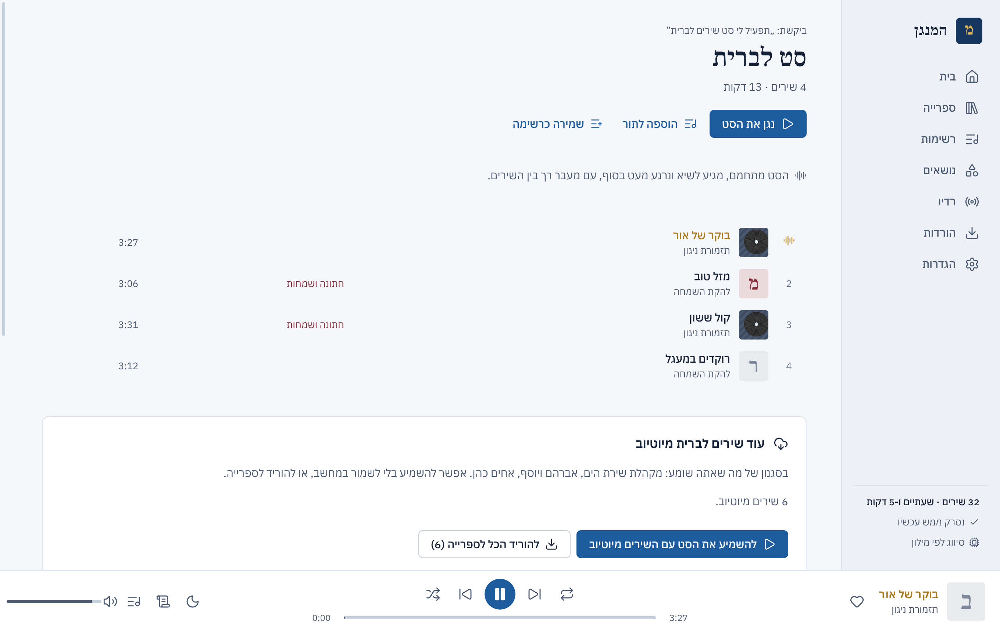

**נגן שלם.** תור עם ערבוב וחזרה, לב לשירים אהובים, טיימר שינה שמנמיך בהדרגה, מילים מקובץ ‎.lrc או ‎.txt שליד השיר, כפתורי נגן בשורת המשימות, מקשי מדיה וחלונית המדיה של Windows.

**רדיו.** כל ערוצי קול חי מיוזיק, עם השידור המרכזי 102.5FM בראש ו„מה מתנגן עכשיו” בכל ערוץ. בלי אינטרנט מוצגת רשימה שמורה.

**מוצא בדיוק את מה שביקשת (חדש ב-1.2).** כל המילים בבקשה חייבות להתאים — בשם השיר, בזמר, באלבום, בתיקייה או בשם הקובץ, עם סובלנות לשגיאת כתיב. „אלי הרצליך” מביא רק את השירים שלו, ולא כל שיר שיש בו „אלי”.

**משלים מיוטיוב.** כשמה שביקשת לא נמצא במחשב, המנגן אומר שאין ומציע מיוטיוב: להוריד שיר מסוים, או לבחור שירים מכל הערוץ של הזמר (הופעות ארוכות וקדימונים לא מסומנים מראש). אפשר גם להדביק קישור לשיר, לפלייליסט או לערוץ. השירים יורדים כ-MP3 עם תמונה, שם שיר ושם זמר, נכנסים לספרייה ומסווגים מיד; מנוע ההורדה רץ בנפרד, נעצר לבד אם נתקע, ומתעדכן כשיוטיוב משתנה.

**עובד גם מאחורי נטפרי (חדש ב-1.2).** החיבורים מאומתים מול מאגר התעודות של Windows, שבו נטפרי שומרת את התעודה שלה — כך ההורדות עובדות עם בדיקת האבטחה פעילה. נטפרי חוסמת חיפוש ביוטיוב מתוך תוכנות; המנגן לא עוקף את זה, אלא אומר זאת בבירור, פותח את החיפוש בדפדפן ומקבל את הקישור שהעתקת. שיר שהרשת חוסמת מסומן ככזה, והשאר ממשיכים לרדת.

**תמונות ושמות תקינים (חדש ב-1.2).** תמונות אלבום מתוך הקבצים, מ-cover.jpg/folder.jpg שבתיקייה, ומיוטיוב בהורדות. שמות שנשמרו בקידוד עברי ישן ונראו כמו „øöåòä” מוצגים נכון, תגיות WMA נקראות, מספר רצועה בתחילת שם קובץ יורד, ובמקום שם הקובץ מוצגת התיקייה. בתפריט של כל שיר אפשר לחפש פרטים ותמונה ברשת ולבחור את השיר הנכון — הפרטים נשמרים במנגן, והקובץ עצמו לא משתנה.

**מתעדכן.** בכל הפעלה (אם לא כובה) הוא בודק אם יצאה גרסה חדשה ומציע להוריד אותה. רכיב ההורדה ומילון הנושאים מתעדכנים מתוך ההגדרות.

## צילומי מסך

| | |
| --- | --- |
| 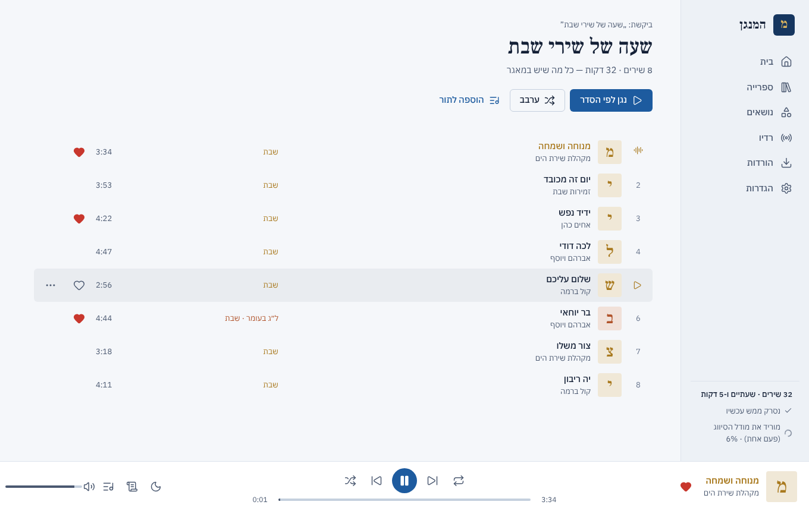 | 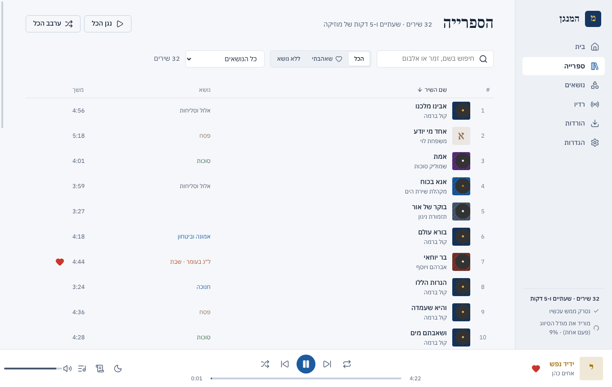 |
| 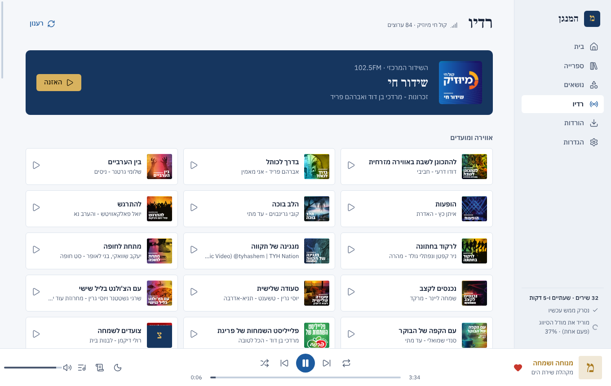 | 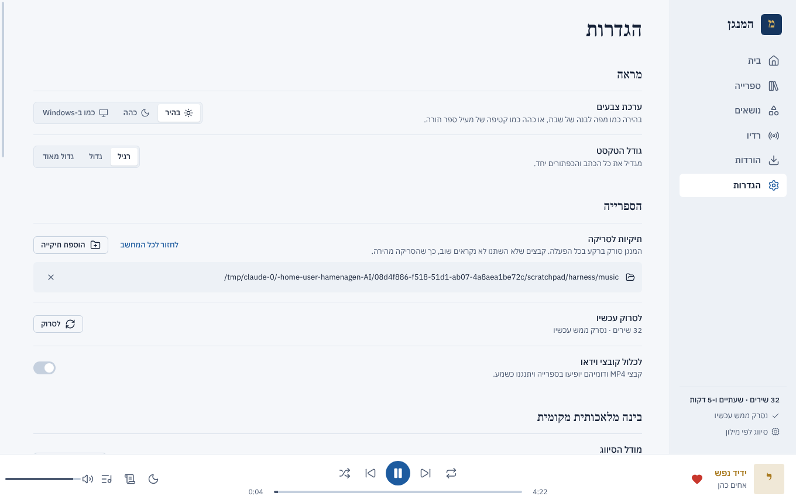 |
| 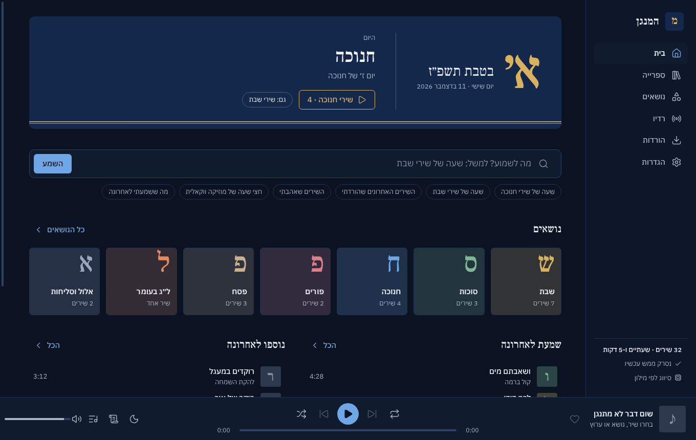 | 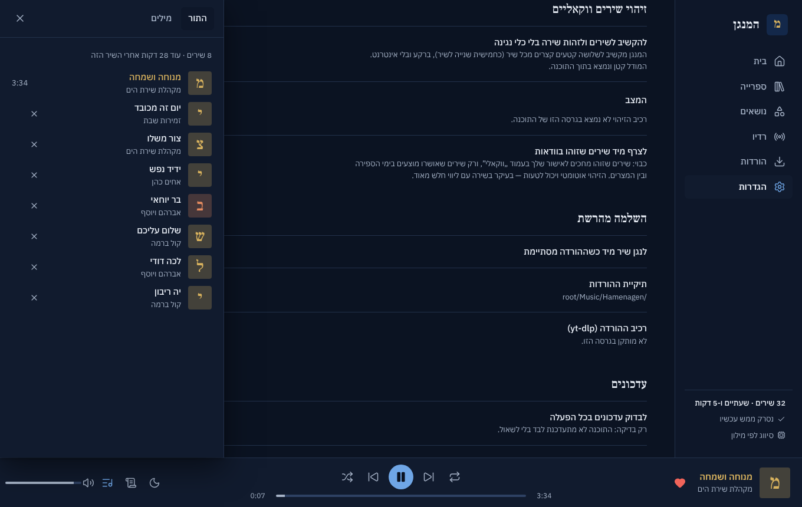 |
| 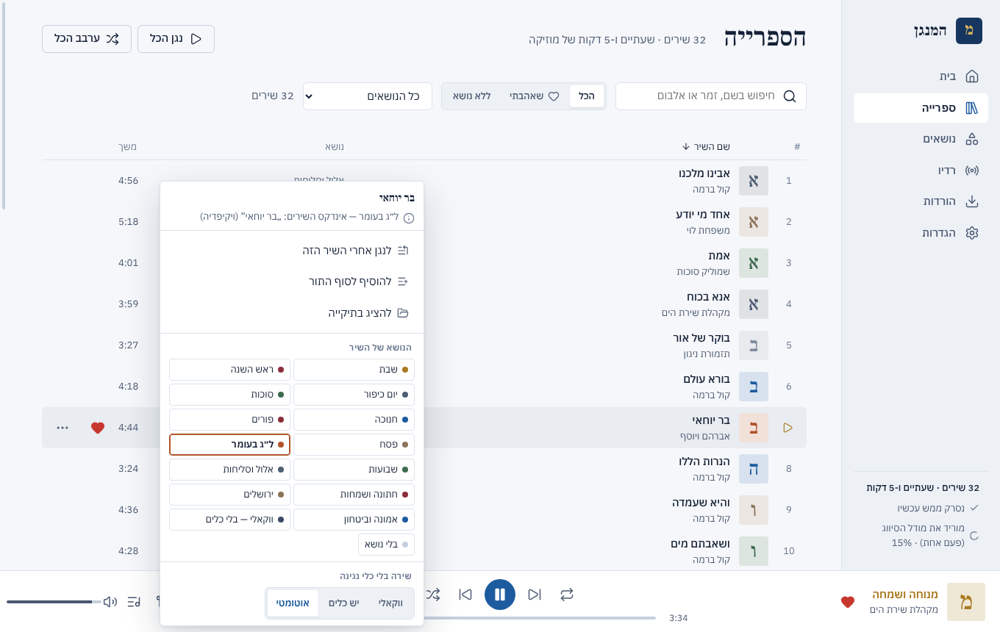 | 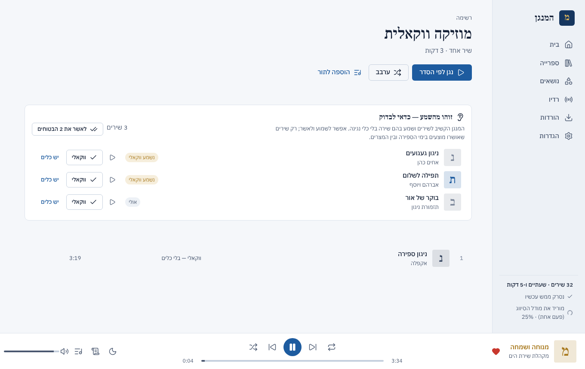 |
| 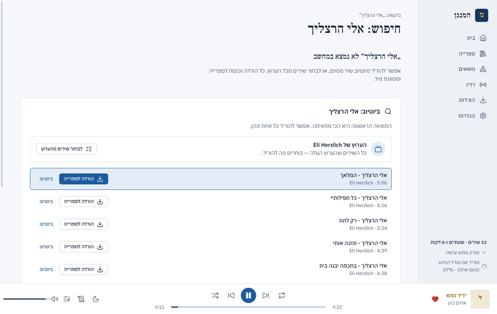 | 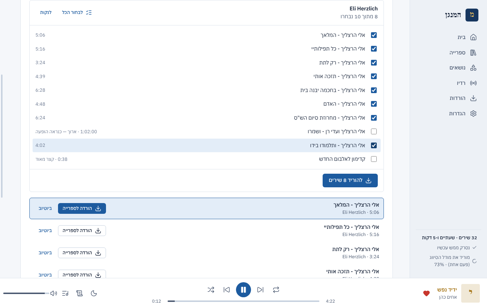 |
| 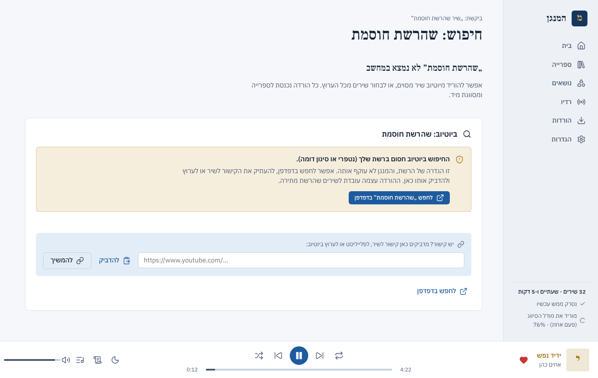 | 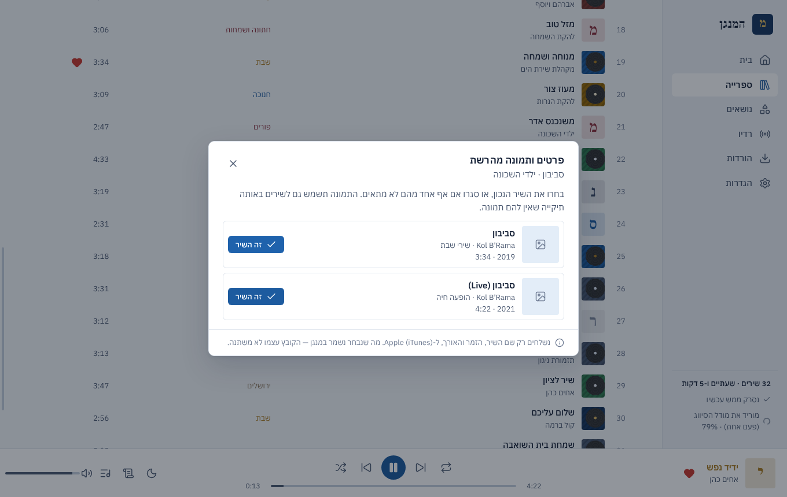 |

## פרטיות

אין משתמשים, אין סיסמאות ואין איסוף נתונים. הספרייה, ההגדרות, הלב וההיסטוריה נשמרים רק במחשב: בגרסה הניידת בתיקייה `data` שליד התוכנה, ובגרסה המותקנת ב-`%APPDATA%\Hamenagen`. התוכנה פונה לרשת רק כדי: לחפש ולהוריד שיר שביקשתם, לנגן ולהציג את ערוצי הרדיו, לבדוק אם יש גרסה חדשה (ולעדכן את רכיב ההורדה), להוריד פעם אחת את מודל הסיווג, ולחפש פרטים ותמונה לשיר כשמבקשים זאת בתפריט שלו — אז נשלחים ל-Apple (iTunes) רק שם השיר, הזמר והאורך.

## למפתחים

```bash
npm install                        # Electron, הגופנים והאייקונים (נשמרים מקומית)
pip install -r requirements.txt    # תלויות הליבה (רשות: mutagen, rapidfuzz, yt-dlp, truststore, onnxruntime, tokenizers, numpy, soundfile)
npm start                          # מריץ את התוכנה; הנתונים בתיקייה data של המאגר
```

- **בדיקות הליבה:** `cd backend && python -m pytest -q`
- **בדיקת הממשק:** `python tests/ui/make_library.py /tmp/music` ואז `xvfb-run node tests/ui/shoot.js /tmp/music /tmp/shots` — מריץ את התוכנה האמיתית מול ספריית דוגמה, עובר על כל המסכים בשתי הערכות ושומר צילומים.
- **הליבה משורת הפקודה:** `python -m hamenagen.cli today`, `... ask "שעה של שירי שבת"`, `... scan ~/Music`.
- **אריזה ושחרור:** ראו [docs/PACKAGING.md](docs/PACKAGING.md). בקצרה: מעדכנים את הגרסה ב-`package.json` וב-`backend/hamenagen/__init__.py`, ממזגים ל-`main` ומריצים את התהליך „בדיקה, בנייה ושחרור” עם הסימון „לפרסם גרסה” (או מוסיפים תגית `v<גרסה>`). ה-CI בונה את שלוש המהדורות, בודק אותן ומפרסם.

מבנה: `backend/hamenagen` — הליבה בפייתון (הבנת בקשות, סיווג, לוח עברי, ספרייה, רדיו, עדכונים); `electron/` — החלון והממשק; `tests/ui` — בדיקת הממשק; `scripts/` — אריזה ואייקונים. פרטים ב-[docs/ARCHITECTURE.md](docs/ARCHITECTURE.md) ושינויים ב-[CHANGELOG.md](CHANGELOG.md).

## רישיונות של רכיבים

הגופנים Frank Ruhl Libre ו-IBM Plex Sans Hebrew — SIL Open Font License. האייקונים — Lucide (ISC). ניגון HLS — hls.js (Apache-2.0). הליבה משתמשת ב-yt-dlp (Unlicense), mutagen (GPL-2.0), rapidfuzz (MIT), onnxruntime (MIT), tokenizers (Apache-2.0), soundfile (BSD-3, עם libsndfile ב-LGPL-2.1) ו-truststore (MIT). להורדות ב-MP3 מצורף ffmpeg בבנייה של [BtbN/FFmpeg-Builds](https://github.com/BtbN/FFmpeg-Builds) ברישיון LGPL-2.1 (הקוד ב-[ffmpeg.org](https://ffmpeg.org/download.html)). מודל הסיווג: `intfloat/multilingual-e5-small` (MIT). מודל זיהוי הווקאלי: CED-Tiny (Apache-2.0, בהמרה של sherpa-onnx).

אינדקס הידע (`song_index.json`, `topic_lexicon.json`) נגזר מ[ויקיפדיה העברית](https://he.wikipedia.org) ומטקסטים של [ספריא](https://www.sefaria.org) ברישיונות פתוחים, ומופץ ברישיון CC BY-SA 4.0 — פרטים ב-[`LICENSE-DATA.md`](backend/hamenagen/data/LICENSE-DATA.md).
